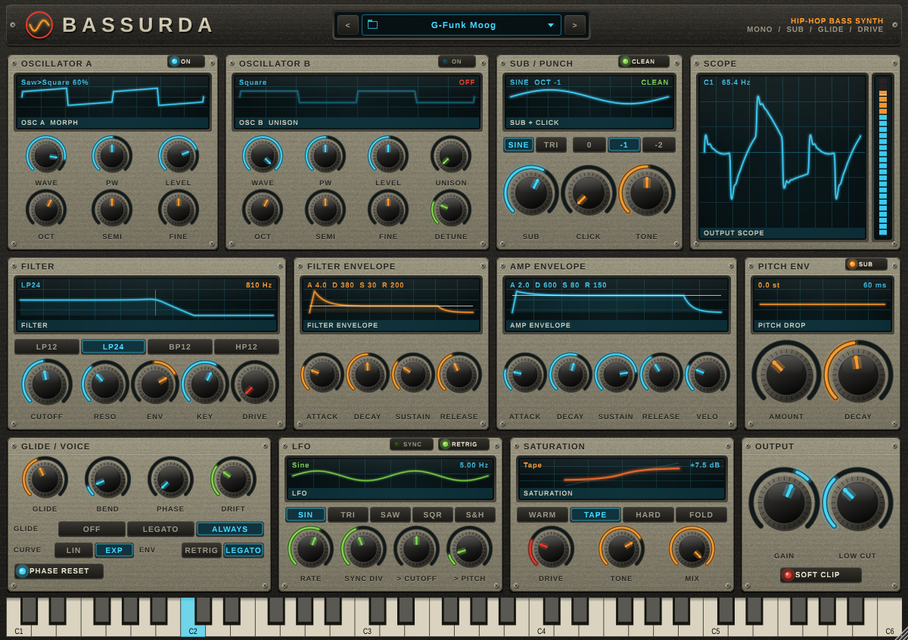

# Bassurda

**Monofoni synth bass plugin za hip-hop, trap, drill i G-funk** (VST3 / AU / Standalone, JUCE, C++17).

Bassurda je napravljen da bas zvuči masivno na klupskom razglasu, a i dalje jasno na zvučniku mobitela:
čisti, fazno poravnati sub ispod, saturacija koja dodaje harmonike iznad, i precizna kontrola udarca i klizanja.



## Značajke

| Sekcija | Što radi | Zašto je bitno za bas |
|---|---|---|
| **Oscilator A** | Morph val: sine → triangle → saw → square (PolyBLEP, bez aliasinga), pulse width, oct/semi/fine | Glavni karakter zvuka |
| **Oscilator B** | Isti morph + **unison do 7 glasova** s detuneom | Reese / "širi" basovi |
| **Sub oscilator** | Sinus ili trokut, oktava 0 / -1 / -2, **CLEAN** prekidač | Čista dubina. CLEAN sub zaobilazi filter i saturaciju, a kasni točno koliko i oversampling pa ostaje u fazi s ostatkom zvuka |
| **Click** | Kratki filtrirani noise burst (level + tone) | Udarac/čujnost na malim zvučnicima |
| **Pitch envelope** | -24 … +48 polutonova, decay 1 ms – 2 s, opcija i za sub | Karakteristični 808 "pad" visine na početku note |
| **Filter** | ZDF state-variable: **LP12, LP24**, BP12, HP12, cutoff, rezonancija, env amount (±), key tracking, drive | LP izlaz ima jedinično pojačanje na DC-u pa rezonancija ne "jede" bas |
| **Filter / Amp ADSR** | Linearni attack (od 0.1 ms), eksponencijalni decay/release kalibrirani da završe točno u zadanom vremenu | Brz, precizan punch; kratak release da se bas ne sudara s kickom |
| **Glide (portamento)** | Off / Legato / Always, Linear (konstantno vrijeme) ili Exp krivulja, 0 – 3 s | Trap/drill slideovi i G-funk portamento |
| **Mono engine** | Note stack (last-note priority, povratak na držanu notu), Retrig/Legato ovojnice, pitch bend do ±24 | Nema preklapanja niskih frekvencija |
| **Phase reset** | Svi oscilatori kreću od iste faze (podesiva početna faza 0–360°), uz de-click kod brzog ponavljanja | Svaki udarac je **identičan** (provjereno testom: razlika 0.0) |
| **Saturacija** | 4× oversampling, Warm (asimetrična, parni harmonici), Tape, Hard, Fold + Tone i Mix | Bas se čuje i na uređajima koji ne reproduciraju fundamental |
| **LFO** | Sine/Tri/Saw/Square/S&H, slobodno ili sync na tempo (1/32 … 4/1, triole, točkaste), na cutoff i pitch | Wobble, vibrato |
| **Analog drift** | Spori nasumični pomak visine po oscilatoru | Manje "digitalan" zvuk |
| **Output** | Gain, Low Cut (20/30/40 Hz), DC blocker, soft clipper | Čist, siguran izlaz |
| **Prikazi** | LCD ekrani: valni oblici, ovojnice uživo, frekvencijski odziv filtera, krivulja saturacije, osciloskop s prikazom note i Hz, metar | Brza vizualna kontrola |

### Tvornički preseti
Init Bass · 808 Boom · Trap Slide 808 · Distorted 808 · Drill Glide · Clean Sub · G-Funk Moog ·
Reese Pressure · Rubber Pluck · Phone Speaker Grit · Wobble Lane · Punch Square

## Tok signala

```
Osc A ─┐
Osc B ─┼─► Drive ─► Filter (LP12/LP24/BP/HP) ─► + Click ─► Amp ADSR ─► Saturacija (4× OS) ─┐
Sub ───┘ (ako CLEAN nije uključen)                                                         ├─► DC/Low Cut ─► Gain ─► Soft Clip ─► Out
Sub ─────────────────────► Amp ADSR ─► kašnjenje = latencija oversamplinga (ako je CLEAN) ─┘
        ▲ pitch: glide + pitch bend + pitch env + LFO + drift
```

## Build

Treba: CMake ≥ 3.22 i C++17 kompajler (Visual Studio 2022, Xcode, GCC/Clang). JUCE 7 se skida automatski.

```bash
cmake -B build -DCMAKE_BUILD_TYPE=Release
```

```bash
cmake --build build --config Release --parallel
```

Rezultat je u `build/Bassurda_artefacts/Release/` (`VST3/`, `AU/` na macOS-u, `Standalone/`).
Kopiraj `Bassurda.vst3` u:
- Windows: `C:\Program Files\Common Files\VST3`
- macOS: `~/Library/Audio/Plug-Ins/VST3` (AU: `~/Library/Audio/Plug-Ins/Components`)
- Linux: `~/.vst3`

Na Linuxu prvo instaliraj: `libasound2-dev libx11-dev libxrandr-dev libxinerama-dev libxcursor-dev libxext-dev libfreetype-dev libfontconfig1-dev libgl1-mesa-dev`.

Lokalni JUCE checkout se može koristiti s `-DJUCE_DIR=/put/do/JUCE`.

GitHub Actions (`.github/workflows/build.yml`) builda Windows, macOS (universal) i Linux verziju na svaki push i
sprema gotove pluginove kao artefakte.

## Testovi

`BassurdaTests` renderira note kroz cijeli procesor i provjerava ono što je bitno za bas:

- svi preseti renderiraju bez NaN-a i bez clippinga
- phase reset: uzastopni udarci su bit-identični
- glide: na pola vremena glida visina je točno na pola, i završava točno na ciljnoj noti
- clean sub ima harmoničku distorziju ispod -80 dB čak i uz punu saturaciju; kroz saturaciju dobiva harmonike
- pitch envelope stvarno spušta visinu
- latencija oversamplinga se javlja hostu

```bash
./build/BassurdaTests_artefacts/Release/BassurdaTests --render demos --snapshot gui.png
```

`--render` sprema demo WAV za svaki preset (kratka trap linija sa slideovima), `--snapshot` sprema sliku GUI-ja.

## Struktura

```
Source/
  Parameters.*        svi parametri (ID-evi, rasponi, prikaz vrijednosti)
  Presets.*           tvornički preseti
  PluginProcessor.*   MIDI, oversampling saturacija, kompenzacija latencije, izlaz
  DSP/                BassEngine (glas), Envelope, Saturator, DspUtils (oscilatori, SVF)
  GUI/                LookAndFeel, LCD prikazi, moduli
  PluginEditor.*      raspored i skaliranje (prozor je resizable)
Tests/TestMain.cpp    offline testovi + render demo zvukova
```

## Licenca

GPLv3 (vidi `LICENSE`). JUCE 7 se koristi pod GPLv3.
